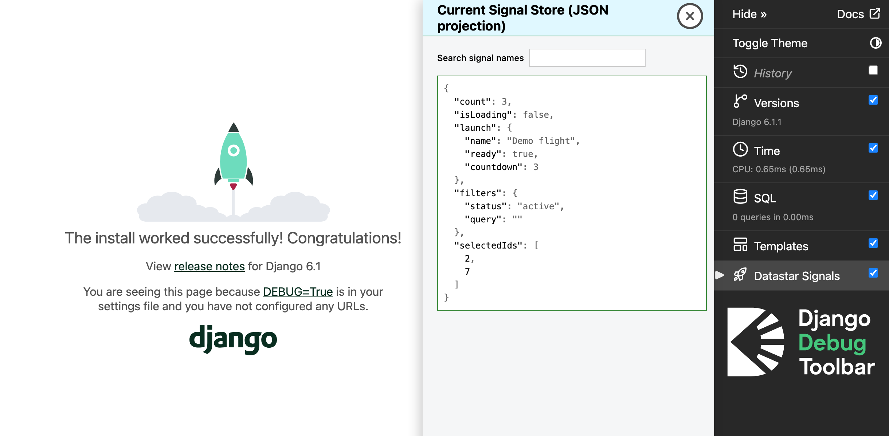
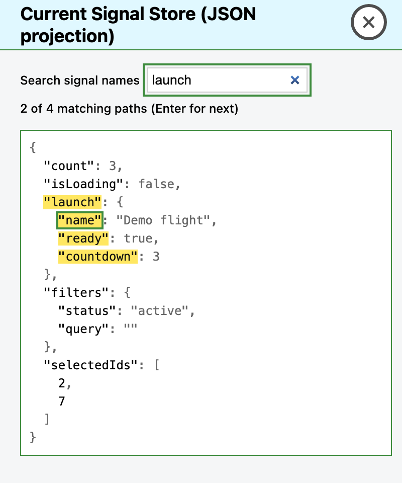

# Datastar Signals for Django Debug Toolbar (development package)

This is an **third-party panel** for [ Django Debug Toolbar ]( https://django-debug-toolbar.readthedocs.io/en/latest/ ). It displays a browser-side JSON projection of the current page's [ Datastar Reactive Signal ]( https://data-star.dev/guide/reactive_signals ) store. This package is still in the process of being developed. It has not been released to PyPI.

## Screenshots

The Datastar Signals panel beside Django’s default welcome page. This temporary demo uses sample data.



Search highlights matching signal names and paths without hiding other values. Press Enter to select the next match.



## Core idea

Django Debug Toolbar provides the panel UI, but Datastar actually owns the signals in the browser. Those signals live only in the page’s DOM (not in the HTTP response), so Django itself can't read them. The page template just includes a status line, a search box, and an output element, and a small script creates a hidden "collector" element in the body that Datastar uses.

The collector is a live text view of the signal store: Datastar writes compact JSON into a data attribute (data-json-signals__terse) and the panel reads that text to render the current state. The panel only shows the current projection — it doesn't keep a history. For example, if a "count" is 2 the collector holds {"count":2}; when it becomes 3 a MutationObserver calls render(), the panel parses the new JSON, and the UI updates. A panel that opens later just reads the collector's current JSON and doesn't need past events.

## Install in a Django project

Use a local development environment with Python 3.10+, Django 5.2+, and Django Debug Toolbar 8.0.0+.

Install the package from a fixed GitHub commit in your project's virtual environment. The package is not on PyPI.

```sh
python -m pip install "git+https://github.com/MarcusL11/django-debug-toolbar-datastar.git@a03ca793f0fda690207ba4405cb93cf219c3b4a2"
```

Keep your existing apps, including `django.contrib.staticfiles` and `debug_toolbar`. Add `django_datastar_toolbar` to `INSTALLED_APPS`:

```python
INSTALLED_APPS = [
    # Keep the other apps from your project here.
    "django.contrib.staticfiles",
    "debug_toolbar",
    "django_datastar_toolbar",
]
```

Add `"django_datastar_toolbar.panels.DatastarStorePanel"` to your existing complete ordered `DEBUG_TOOLBAR_PANELS` list. This setting replaces the toolbar defaults. Keep every other panel that you want to use.

For a short test only, you can use the History panel and the Datastar panel. This list removes the other default panels. Copy the complete panel list for your installed toolbar version if you want to keep them.

```python
DEBUG_TOOLBAR_PANELS = [
    "debug_toolbar.panels.history.HistoryPanel",
    "django_datastar_toolbar.panels.DatastarStorePanel",
]
```

Installing the package does not activate the toolbar or the panel. If your project does not use Django Debug Toolbar yet, follow its [installation guide](https://django-debug-toolbar.readthedocs.io/en/latest/installation.html). Add its middleware and URLs to your project. Set `DEBUG=True` for local development, allow your local IP in `INTERNAL_IPS`, and enable the app-directory template loader (`APP_DIRS=True`). The page must load the official full Datastar bundle. The core bundle alone does not include the built-in `data-json-signals` attribute.

Run Django checks and find the add-on script:

```sh
python manage.py check
python manage.py findstatic django_datastar_toolbar/js/datastar_store.js
```

Start your project and open a page that uses Datastar. Select Datastar Signals in the toolbar, then change a sample signal and check the JSON display. The package does not ship or inject any Datastar bundle or Inspector assets.

Use sample data only. This panel does not hide sensitive values, and its raw JSON projection remains in the page DOM.

## AI-assisted development

Large language models (LLMs) were used to help generate portions of this
project's code and documentation. All LLM-assisted content was reviewed and edited and
by myself.

## Run tests

Run the Python panel tests:

```sh
python -m pytest tests/python/test_panel.py
```

Run the JavaScript tests in headless Chromium. Use Node.js 22.12 or newer in the 22 series, or use Node.js 24:

```sh
npm ci
npx playwright install chromium
npm test
```

The JavaScript tests use Vitest and Playwright. They test the DOM without a Django server or Datastar bundle.

## Roadmap to a PyPI release

- [ ] Select supported Python, Django, toolbar, Datastar, and browser versions. Run installed-wheel tests across this list.
- [ ] Add browser tests to CI for lazy and eager panels, shadow and light DOM, and live signal changes.
- [ ] Review license notices and third-party assets in the final source and build files.
- [ ] First version. Update the install steps after the PyPI release.
- [ ] Build wheel and source archives from the release commit. Check metadata, license, templates, static files, and the installed result.
- [ ] Testing PyPI install in a Django project. 
- [ ] Request s third-party panel listing request after release.
